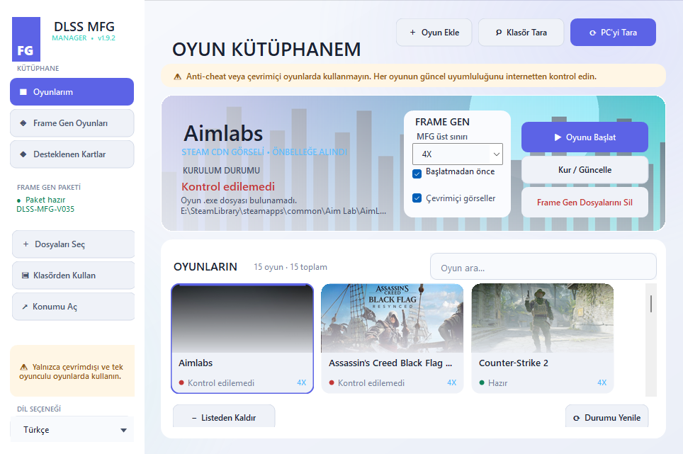

# DLSS MFG Manager

> [Türkçe belge](README.md) · English documentation

[Download the latest release](https://github.com/ferhatmete/dlss-mfg-manager/releases/latest) · [Safe use](SECURITY.md) · [Third-party notices](THIRD_PARTY_NOTICES.md)

DLSS MFG Manager is a source-available .NET 8 WinForms utility for managing per-game `dlssg_for_sm86` installations on Windows 10/11. It targets RTX 20-series (SM75) and RTX 30-series (SM86) GPUs.

> [!CAUTION]
> **Use only with offline / single-player games.** Loading a proxy DLL in a game with anti-cheat or online services can lead to account penalties or a permanent ban. An entry in the built-in game catalog is not a compatibility guarantee. Check current game-specific information before every installation.



## What does it do?

- Automatically scans Steam, Xbox/Microsoft Store, Epic, GOG, EA app, Ubisoft Connect, Battle.net, Rockstar, Amazon Games, Riot, and itch.io installations.
- Scans user-selected local/portable game folders and remembers those roots for later scans.
- Lets you manually select the game's real rendering executable.
- Installs your selected `version.dll` and `dlssg_sm86.ini` beside the game executable.
- Backs up files with the same names before replacing them.
- Verifies the DLL with SHA-256 and validates the INI setting.
- Configures `MaxGeneratedFrames` for 2X, 3X, or 4X.
- Optionally checks and repairs missing or modified files before launch.
- Removes managed files and restores the first original backup when available.
- Persists the game list and user preferences.
- Displays the selected game's Steam CDN artwork as a wide launcher background and progressively fills missing library-card artwork in the background, two requests at a time.
- Includes a modern light launcher-inspired sidebar, scrollable visual game cards, a wide hero area, and a responsive action surface.
- Includes Turkish and English UI, a supported-GPU window, and a searchable game catalog.

## What it does not do

- It does not bundle or download `dlssg_for_sm86` DLL/INI files.
- It does not guarantee compatibility with any game.
- It does not disable or bypass anti-cheat.
- It does not modify save games, drivers, or Windows system files.
- It is not affiliated with NVIDIA, Microsoft, game developers, or any upstream project listed below.

## Requirements

- Windows 10 or Windows 11, x64
- NVIDIA RTX 20-series (SM75) or RTX 30-series (SM86) GPU
- A current NVIDIA driver
- A compatible DirectX 12 game with a DLSS Frame Generation integration
- Write permission for the game directory

The release EXE is self-contained; the target PC does not need a separate .NET installation.

## Download and integrity verification

1. Open the repository's **Releases** section.
2. Download `DlssMfgManager.exe` from the latest release.
3. Compare its digest with `SHA256SUMS.txt` from the same release.

PowerShell verification:

```powershell
Get-FileHash .\DlssMfgManager.exe -Algorithm SHA256
```

SHA-256 for the v1.9.2 Windows x64 EXE:

```text
09C25191AF2D9C6BC4BDF33AB6E59FD7F432955F5D9F7E45FBBC1BC02A2214A9
```

The application is not digitally signed. Windows SmartScreen may therefore show an “Unknown publisher” warning on first launch. Download only from this repository's Releases section and verify the hash.

## Obtaining the required Frame Generation files

This application does not redistribute third-party runtime files. Obtain current files from the primary upstream project:

- [`sdli1995/dlssg_for_sm86`](https://github.com/sdli1995/dlssg_for_sm86)
- [Upstream English README](https://github.com/sdli1995/dlssg_for_sm86/blob/main/README.en.md)
- [Upstream installation guide](https://github.com/sdli1995/dlssg_for_sm86/blob/main/docs/INSTALL.en.md)
- [Upstream releases](https://github.com/sdli1995/dlssg_for_sm86/releases)

The manager needs these two files:

```text
version.dll
dlssg_sm86.ini
```

Read the upstream release notes, signature/hash information, and `THIRD_PARTY_NOTICES.txt`. Do not download repackaged DLLs from unrelated websites.

## Step-by-step usage

### 1. Prepare the application

1. Download `DlssMfgManager.exe` from a release.
2. Move it to a permanent folder where you have write access.
3. Verify the EXE hash.
4. Completely exit the game and its launcher.

### 2. Select Frame Gen files

Click **Select Frame Gen Files** and select both `version.dll` and `dlssg_sm86.ini` from the upstream package.

Imported files are copied to:

```text
%LOCALAPPDATA%\DlssMfgManager\Package
```

Use **Use Folder** if you want to reference the files in their current directory without copying them. Moving those files later will invalidate the saved path.

### 3. Add games

There are three methods:

- **Scan PC:** Scans Steam manifests and orphaned `steamapps\common` folders, Epic manifests, Xbox `MicrosoftGame.config` records, GOG and Windows installation records, EA, Ubisoft, Battle.net, Rockstar, Amazon, Riot, itch.io, and common local game-library folders. Candidates are shown for confirmation before anything is changed.
- **Scan Folder:** Scans a user-selected root for launcher-free, portable, or custom-location games. The root is remembered for later **Scan PC** runs.
- **Add Game:** Lets you manually select the game's real rendering executable.

The real executable is often under a folder such as `Binaries\Win64`, `bin\x64`, or a game-specific equivalent. Discovery does not evaluate where a file came from or its licence status; it only inspects accessible local 64-bit executable candidates. Auto-detection remains a best-effort guess, so inspect every path before installation. Encrypted/inaccessible legacy Microsoft Store `WindowsApps` packages cannot be managed; accessible Xbox `XboxGames` installations are supported.

### 4. Check current compatibility online

The **Frame Gen Game List** is an offline reference catalog. It can be incomplete or outdated. A game missing from the catalog may work, and a listed game may stop working after an update.

Before installation:

1. Confirm that the game can be played locally/offline.
2. Check for anti-cheat or online components.
3. Research current `dlssg_for_sm86` issues and game-specific installation notes.
4. If helpful, use **Check Selected Game Online** in the catalog window.

With the Turkish interface selected, this action opens Google with Turkish language/region parameters and adds Turkish compatibility and setup terms. The English interface continues to use an English query.

### 5. Use game artwork (optional)

When **Use online game artwork** is enabled, the application uses the Steam AppID captured during automatic discovery. If no AppID is known, it searches the Steam store by game name, executable product metadata, and installation folder name. Artwork is downloaded and cached automatically from Steam's official CDN. If no Steam image is available for a local game, the application generates a cover from its executable icon and title; no manual refresh button is required. Missing library artwork is filled in the background without blocking the UI and with at most two simultaneous requests.

If Steam store metadata is missing or temporarily unavailable, the manager probes the official Steam CDN paths that SteamDB also links to instead of crawling SteamDB itself. The [SteamDB FAQ](https://steamdb.info/faq/) says that it has no public API and disallows automated crawling. Disabling online artwork uses only the local gradient.

### 6. Select the MFG level

| UI option | INI value | Meaning |
|---|---:|---|
| 2X | `MaxGeneratedFrames=1` | At most 1 generated frame per real frame |
| 3X | `MaxGeneratedFrames=2` | At most 2 generated frames per real frame |
| 4X | `MaxGeneratedFrames=3` | At most 3 generated frames per real frame |

This is a ceiling. The actual level still depends on the game's integration and the upstream runtime.

### 7. Install and launch

1. Click **Install / Update**.
2. Read and accept the online/anti-cheat warning.
3. When the installation status is **Ready**, click **Launch Game**.
4. Enable DLSS Frame Generation in the game's graphics settings.

When **Automatically check and repair before launch** is enabled, the manager verifies file presence, the DLL hash, and the INI value before every launch. Missing or changed managed files are reinstalled from your selected package, so you do not have to copy them again for every session.

### 8. Uninstall

The red **Remove Frame Gen Files** button:

- Removes the managed `version.dll` and `dlssg_sm86.ini`.
- Restores files that existed before the first managed installation when a backup is available.
- Refuses to automatically delete a file that appears to have been modified by the user after installation.

Backups are stored under the game directory:

```text
.dlss-mfg-manager-backups\yyyyMMdd_HHmmss_fff\
```

## Buttons and states

- **Blue — Install / Update:** Installs Frame Gen files and updates the INI level.
- **Red — Remove Frame Gen Files:** Removes the managed installation and restores originals when possible.
- **Green — Launch Game:** Repairs first when enabled, then starts the game with its directory as the working directory.
- **Ready:** Files and settings match the selected package.
- **Not installed:** One or more managed files are missing.
- **Repair required:** The DLL hash or INI setting does not match.
- **Could not verify:** The game executable or package source is inaccessible.

Action buttons resize proportionally and retain their full labels when the window becomes narrow.
The **Language** selector in the lower-left corner shows the active language and exposes Turkish/English through a visible down-arrow menu.

## Important safety notes

- Do not use this in anti-cheat or online games.
- Keep the game and launcher closed while installing, updating, or removing files.
- Recheck compatibility after every game update.
- Obtain third-party DLLs only from trusted upstream sources and verify signatures/hashes.
- Do not follow guides that ask you to completely disable antivirus protection.
- If the game directory already contains `version.dll`, identify its owner before replacing it. The manager creates a backup, but multiple mods can still conflict.
- Follow upstream game-specific instructions when a different proxy name such as `winmm.dll`, `dxgi.dll`, or `dbghelp.dll` is required. This manager version directly manages the `version.dll` method.
- A low base frame rate can increase latency and visual artifacts at higher MFG levels.
- Use is at your own risk. No guarantee is made regarding accounts, game files, stability, performance, or compatibility.

Read [SECURITY.md](SECURITY.md) for more safety information.

## Troubleshooting

### My game is not in the catalog

Use **Add Game** and select the real rendering executable. The catalog is not an authoritative compatibility list. Search the game's name, current version, and `dlssg_for_sm86` compatibility online.

### The Frame Generation option is missing

- Confirm that the game has a DLSS Frame Generation integration.
- Make sure the game is running in DX12 mode.
- Select the real rendering EXE directory, not a launcher.
- Review upstream logs and the current installation guide.
- Check the NVIDIA driver and upstream runtime versions.

### The game does not start or crashes

1. Exit the game.
2. Use **Remove Frame Gen Files**.
3. Verify game files through the launcher.
4. Search upstream issues for the specific game and version.

### Windows blocks the EXE

Confirm that the download came from this repository's Releases section and that SHA-256 matches. The EXE is not code-signed. A SmartScreen warning alone is not proof of malware, but never run the file when its hash does not match.

## Stored data and privacy

Game list and preferences:

```text
%LOCALAPPDATA%\DlssMfgManager\settings.json
```

This file also stores extra scan roots added through **Scan Folder**. The application does not blindly crawl every unselected directory on every drive.

Imported source package:

```text
%LOCALAPPDATA%\DlssMfgManager\Package
```

Downloaded game artwork:

```text
%LOCALAPPDATA%\DlssMfgManager\ArtworkCache
```

The application sends no telemetry, requests no account credentials, and does not automatically download DLLs. When online artwork is enabled, records without a known Steam AppID send the game name to Steam's store-search service. Artwork is accepted only from Steam HTTPS image domains and cached locally. SteamDB itself is not crawled. You can disable this feature on the main screen. **Check Online** only opens a prepared search in the default browser.

## Building from source

Requirements:

- Windows 10/11 x64
- [.NET 8 SDK](https://dotnet.microsoft.com/download/dotnet/8.0)

```powershell
dotnet build .\DlssMfgManager.sln --configuration Release
```

To publish a single self-contained Windows EXE:

```powershell
.\publish.ps1
```

Output:

```text
outputs\win-x64-v1.9.2\DlssMfgManager.exe
```

## Upstream projects and acknowledgements

- [`sdli1995/dlssg_for_sm86`](https://github.com/sdli1995/dlssg_for_sm86) — primary upstream source for the `version.dll` and `dlssg_sm86.ini` format managed by this application.
- [`Coldwood1026/dlssg_for_sm75`](https://github.com/Coldwood1026/dlssg_for_sm75) — RTX 20 / SM75 adaptation source credited by the primary upstream project.
- [`Nukem9/dlssg-to-fsr3`](https://github.com/Nukem9/dlssg-to-fsr3) — GPLv3 project/loader lineage identified by the primary upstream project's third-party notice.

See [THIRD_PARTY_NOTICES.md](THIRD_PARTY_NOTICES.md) for detailed attribution and licensing boundaries.

## Independence notice

DLSS MFG Manager is an independent community utility. It is not created, approved, or supported by NVIDIA, Microsoft, Valve, Epic Games, game developers, or the upstream maintainers named above. Product and game names are trademarks of their respective owners.
